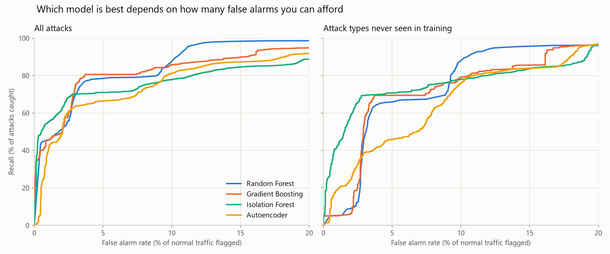

# Network Anomaly Detection

Can a model catch network attacks it has never seen before? On the NSL-KDD benchmark, supervised classifiers score 99.9% recall in cross-validation but miss about a third of attacks on the test set, mostly attack types that never appear in training. This project measures that gap and tests whether anomaly detection, trained only on normal traffic, closes it.



**Key findings**
- **Supervised models only recognise what they were taught.** The best one (gradient boosting) catches 79% of attack types seen in training, but only 44% of unseen types.
- **Anomaly detection holds up on new attacks.** Isolation Forest, which never sees a single attack during training, catches 62% of unseen attacks at a 2.2% false alarm rate, 42% more than the best supervised model.
- **The best model depends on the false-alarm budget.** Below about 9% false alarms, Isolation Forest catches the most unseen attacks (at 2%, roughly 7× more than random forest). Above that, random forest with a tuned cutoff wins, reaching 95% of unseen attacks at a 13% false alarm rate.

## The problem

[NSL-KDD](https://www.unb.ca/cic/datasets/nsl.html) is a standard intrusion detection benchmark: 125,973 training and 22,544 test connections, each described by 41 traffic features and labelled normal or one of 39 attack types. The test set deliberately includes **17 attack types that don't exist in the training set**, which account for 3,750 test rows (29% of test attacks).

Cross-validation can't see this problem, because every fold only contains known attack types:

| | CV recall (training data) | Test recall |
|---|---|---|
| Gradient boosting | 0.999 | 0.686 |
| Random forest | 0.998 | 0.613 |

So I report recall separately for **seen** and **unseen** attack types throughout.

## Approach

1. **Pipeline.** A scikit-learn `Pipeline` one-hot encodes the 3 categorical features and scales the 37 numeric ones. It's fitted on training data only, so test data never influences preprocessing.
2. **Supervised baselines.** Logistic regression, decision tree, random forest and gradient boosting, compared with 5-fold stratified cross-validation and on the test set.
3. **Anomaly detection.** An Isolation Forest and an autoencoder (an MLP with a 16-unit bottleneck), trained **only on normal traffic**, with no attack labels. Traffic that looks unlike normal gets a high suspicion score.
4. **Choosing a cutoff without the test set.** Each detector's alarm cutoff is the 95th percentile of scores on normal *training* traffic, a 5% false-alarm budget. For supervised models, I use out-of-fold predictions (`cross_val_predict`), because a model's scores on its own training rows are overconfident.
5. **Evaluation.** Precision, recall, F1, ROC-AUC and **false alarm rate** (share of normal traffic flagged), plus recall on seen vs unseen attack types and on each attack category.
6. **Explainability.** Permutation importance on the original 41 features shows what each model relies on.

## Results

### All models at their default cutoffs

| Model | Trained on attacks? | Precision | Recall | False alarms | Unseen recall |
|---|---|---|---|---|---|
| Logistic regression | yes | 0.918 | 0.624 | 7.4% | 0.409 |
| Decision tree | yes | 0.958 | 0.674 | 3.9% | 0.441 |
| Random forest | yes | 0.968 | 0.613 | 2.7% | 0.233 |
| Gradient boosting | yes | 0.970 | 0.686 | 2.8% | 0.438 |
| **Isolation Forest** | **no** | **0.975** | 0.651 | **2.2%** | **0.620** |
| Autoencoder | no | 0.928 | 0.685 | 7.1% | 0.515 |

### Recall by attack category

| Model | DoS | Probe | R2L | U2R |
|---|---|---|---|---|
| Gradient boosting | **0.873** | 0.810 | 0.115 | 0.080 |
| Isolation Forest | 0.800 | **0.898** | 0.030 | **0.640** |
| Autoencoder | 0.801 | 0.693 | **0.369** | 0.600 |

Loud attacks (DoS floods, Probe scans) are caught by every model. Quiet ones are much harder: **R2L** (remote login attempts such as password guessing) are often single, ordinary-looking connections.

### Threshold tuning

Random forest had the best ROC-AUC (0.961) but the worst unseen recall (0.233): it ranks attacks well, but most of them score below the default 0.5 cutoff. Moving the cutoff, chosen from out-of-fold training scores, changes the picture:

| Random forest | Default cutoff | Tuned cutoff |
|---|---|---|
| Recall | 0.613 | **0.980** |
| Unseen recall | 0.233 | **0.951** |
| R2L recall | 0.057 | **0.914** |
| False alarm rate | 2.7% | 13.0% |

It's a trade-off rather than a free win: 13% false alarms would overwhelm most security teams. That's why the chart above, comparing models across every possible cutoff, is the fairest comparison.

### What the models rely on

Permutation importance (the drop in ROC-AUC when a feature is shuffled):
- **Gradient boosting** relies on *fingerprints* of known attacks: bytes sent (`src_bytes`, `dst_bytes`) and connection counts.
- **Isolation Forest** relies on *signs that something is broken*: an unusual `service`, how the connection ended (`flag`), and error rates.

This explains Isolation Forest's 3% R2L recall: a password-guessing attack uses a normal service and completes normally, so there's nothing unusual for it to notice.

## Limitations

- **Some attacks are invisible to these features.** NSL-KDD describes traffic patterns, not connection contents. Reliably catching R2L attacks would need payload inspection or login logs.
- **False-alarm budgets don't transfer exactly.** A 5% budget set on training traffic produced 2.2% (Isolation Forest), 7.1% (autoencoder) and 13% (tuned random forest) on test traffic. A deployed system would need to monitor and re-tune its cutoff.
- **U2R results are noisy:** only 200 test rows (52 in training).
- **No hyperparameter tuning, deliberately.** Cross-validation scores are already at 0.999, so tuning would optimise noise. The test-set gap comes from attack types missing from the training data, which no hyperparameter can fix.
- **Permutation importance underestimates correlated features.** The six error-rate features overlap, so each looks less important than the group really is.
- **NSL-KDD is dated** (derived from 1998 traffic). The method transfers, but the numbers wouldn't carry over to modern networks.

## Project structure

```
src/nad/
├── data.py       # loading, labels, attack categories
├── features.py   # preprocessing (one-hot encoding + scaling)
├── train.py      # pipeline builder; trains and saves a decision tree
├── compare.py    # supervised model comparison with cross-validation
├── anomaly.py    # Isolation Forest and autoencoder
├── tune.py       # cutoff tuning with out-of-fold predictions
├── evaluate.py   # metrics: false alarm rate, seen/unseen, per-category recall
├── plot.py       # recall vs false alarm curves
├── explain.py    # permutation feature importance
└── cli.py        # the `nad` command
tests/            # pytest unit tests
results/          # every table and chart in this README
```

## How to run

```bash
python -m venv venv
venv\Scripts\activate          # macOS/Linux: source venv/bin/activate
pip install -r requirements.txt
pip install -e .

nad all          # reproduces every file in results/ (about 6 minutes)
nad --help       # lists the individual steps
python -m pytest # runs the tests
```

All models use fixed random seeds, so `nad all` reproduces the results exactly.


